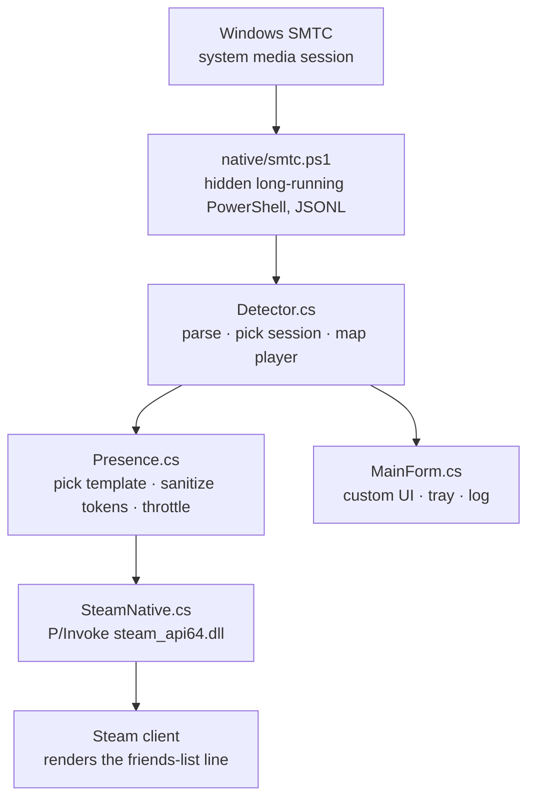

<div align="center">

# 🎵 SteamTune

**Show what you're listening to on your Steam friends list**

Native Windows desktop app · single exe, ~140 KB · no Electron, no Node, no WebView

[](#)
[](#)
[](#)
[](#)
[](LICENSE)

[中文](README.md) · [**English**](README.en.md)

</div>

> **Note**: this project ships as source + releases and is **not published on Steam**.
> The second line in the friends list is rendered by Steam from the app's own rich presence
> templates, so you need your own Steamworks AppID — see
> “🔑 To actually show the song, you need your own AppID” below.

---

## ✨ What it is

SteamTune reads the Windows Global System Media Transport Controls (SMTC) session, figures out **which player is playing and what track it is**, then publishes that through the official Steamworks API. Your friends see more than "In-Game: SteamTune":

```text
YourName
SteamTune
Listening to <track info>
```

> The third line is built from whatever is playing and from the chosen style (song / song — artist / song — artist · via player); switch it in the app's display settings. The artist part is dropped when the track has none.

- 🎧 **Player detection**: NetEase Cloud Music, QQ Music, Kugou, Kuwo, Spotify, foobar2000, AIMP, MusicBee, Apple Music, VLC, browser playback, and more
- 🪟 **Native UI**: hand-drawn C# / WinForms — no Electron, no WebView, no Node runtime; tray icon, animated equalizer, dark cards
- 🔒 **Doesn't touch the client**: no injection, no patching, no proxying — only the official API, which is what Steam requires for a store release
- 🌏 **Localized templates**: Simplified Chinese, Traditional Chinese and English rich presence strings included
- 🧪 **Built-in diagnostics**: reads back the presence Steam actually stored, so "published but no template" is visible immediately

## 🚀 Quick start

### Option 1 — download a build

1. Open the Releases page: <https://github.com/XGSDGY/steamtune/releases/latest>
2. Download `SteamTune-win-x64.zip`
3. Unzip and run `SteamTune.exe` (Steam must be running and signed in)

### Option 2 — build it yourself

All you need is the .NET Framework 4.8 that ships with Windows — **no** Visual Studio, .NET SDK or Node:

```powershell
git clone https://github.com/XGSDGY/steamtune.git
cd steamtune
powershell -ExecutionPolicy Bypass -File native\build.ps1
```

Output in `dist\`:

```text
SteamTune.exe                  ~140 KB
steam_api64.dll                official Steamworks runtime
richpresence_localization.json templates for the local preview
```

CLI flags:

```powershell
.\dist\SteamTune.exe --once      # probe once and print the current track
.\dist\SteamTune.exe --preview   # UI only, no Steam connection
.\dist\SteamTune.exe --tray      # start hidden in the tray
```

## 🔑 To actually show the song, you need your own AppID

The second line in the friends list is rendered by Steam from **the rich presence localization of that AppID**. The free test app `480 (Spacewar)` has no such templates, so it only shows `In-Game: Spacewar` — a server-side Steam rule, not a bug here.

Three steps:

1. Create your own app on [Steamworks](https://partner.steamgames.com/) (Steam Direct, $100 per app) and note its **AppID**;
2. Upload `dist\richpresence_localization.json` (or `steam/richpresence_localization.vdf`) under **Community → Rich Presence**, then hit **Publish**;
3. Tray menu → **Set AppID…** (or write the AppID into `steam_appid.txt` next to the exe) and restart.

> Saving without publishing does nothing. You do **not** need to ship the store page to test locally.
> Full checklist: [docs/PUBLISHING.md](docs/PUBLISHING.md).

## 🧠 How it works



Implementation notes:

- **WinRT SMTC** needs Windows SDK metadata for direct P/Invoke, so probing runs through the system PowerShell (windowless, dies with the host, parent-PID watchdog);
- **Encoding**: every Steam interface is UTF-8; Chinese titles are marshaled manually to avoid ANSI mojibake;
- **Limits**: Steam caps keys at 64 bytes and values at 256; tokens are truncated to 100 chars / 200 bytes;
- **Template fallback**: without an artist field the app switches to a template that has no `%artist%`, so you never get a dangling "Listening to X — ".

## 🗂 Project layout

```text
native/                 C# sources, build script, embedded probe script
  build.ps1             csc build -> dist/
  smtc.ps1              SMTC probe (embedded into the exe, extracted at runtime)
  vendor/steam_api64.dll
build/icon.ico|png      app icon (generated by scripts/make-icon.js)
steam/                  rich presence localization + SteamPipe scripts
docs/PUBLISHING.md      store submission / bring-your-own-AppID guide
.github/workflows/      CI build and release
```

## ⚙️ Configuration

`%APPDATA%\SteamTune\config.json` (falls back to the exe folder when AppData is not writable — portable mode).

| Key | Meaning | Default |
| --- | --- | --- |
| `presence.enabled` | master switch | `true` |
| `presence.style` | `withPlayer` / `artist` / `title` | `withPlayer` |
| `presence.onPaused` | `keep` last track, or `clear` | `keep` |
| `presence.onIdle` | `keep` / `clear` | `clear` |
| `presence.maxTokenLength` | max chars per token (≤100) | `100` |
| `detect.intervalMs` | probe interval | `1500` |
| `detect.blacklist` | AUMID fragments to ignore | `["douyin.exe"]` |
| `window.closeToTray` | X hides to tray instead of quitting | `false` |
| `window.startInTray` | start hidden in the tray | `false` |

## ❓ FAQ

<details>
<summary><b>Friends only see <code>In-Game: Spacewar</code>, no song</b></summary>

You are on the 480 test AppID, which has no rich presence templates. Use your own AppID and publish the localization (see above).
</details>

<details>
<summary><b>I used my own AppID and it still doesn't show</b></summary>

Check that you pressed **Publish** (not just Save), that the template names match `steam_display` exactly (including `#`), that the viewer's client language has an entry (`english` / `schinese` / `tchinese`), and press F5 in the friends list. The `steam presence:` line in the app log shows exactly what Steam stored.
</details>

<details>
<summary><b>Can this get my account banned?</b></summary>

No. It never injects into or patches the Steam client; it only calls the official `ISteamFriends::SetRichPresence`, the same API games use.
</details>

<details>
<summary><b>Why does it say "In-Game: SteamTune" instead of "Listening to music"?</b></summary>

The first line is always the app name from the Steam store metadata; the rich presence text is the second line. The app name is configured when you publish.
</details>

<details>
<summary><b>macOS / Linux / Steam Deck?</b></summary>

Not supported. SMTC is a Windows-only media session API, and Proton does not expose it.
</details>

<details>
<summary><b>Album art, lyrics, progress bar?</b></summary>

Not possible. Steam rich presence is text-only.
</details>

## 🛠 Development

- C# 5, .NET Framework 4.8, hand-drawn WinForms UI (no XAML, no third-party packages)
- Built with the bundled `csc.exe` — see `native/build.ps1`
- Self-checks: `native/test-tray.ps1` (tray behaviour), `SteamTune.exe --once` (probe pipeline)
- Adding a player: append a regex rule to `PlayerRules` in `native/Detector.cs`
- Changing the text: edit `steam/richpresence_localization.json` and re-upload it to Steamworks

## 📄 License

Code is released under [MIT](LICENSE). `native/vendor/steam_api64.dll` is part of the Valve Steamworks SDK redistributable and is governed by the Steamworks SDK license.

## ⚠️ Disclaimer

Not affiliated with Valve. Use it in accordance with the [Steam Subscriber Agreement](https://store.steampowered.com/subscriber_agreement/) and the Steamworks terms.
