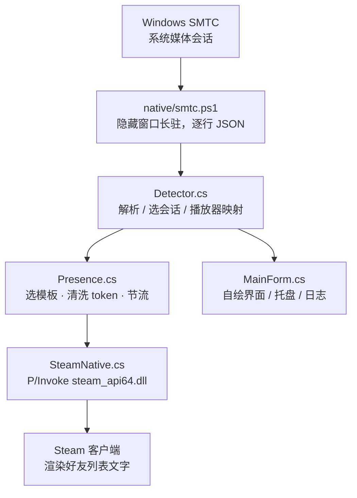

<div align="center">

# 🎵 SteamTune

**把正在听的歌，显示在你的 Steam 好友列表里**

原生 Windows 桌面程序 · 单个 exe 约 140 KB · 不依赖 Electron / Node / WebView

[](#)
[](#)
[](#)
[](#)
[](LICENSE)

[**中文**](README.md) · [English](README.en.md)

</div>

> **说明**：本项目以源码 + Release 的形式发布，**未在 Steam 商城上架**。
> 好友列表里的歌名由 Steam 用「应用自己的 rich presence 模板」渲染，所以需要你自己的
> Steamworks AppID（步骤见下文「🔑 想让好友看到歌名？需要你自己的 AppID」一节）。

---

## ✨ 它是什么

SteamTune 读取 Windows 的系统媒体会话（SMTC），识别你**正在用哪个播放器、在听哪首歌**，再通过官方 Steamworks 接口 `ISteamFriends::SetRichPresence` 把状态发布到 Steam。好友打开好友列表，看到的不只是「正在玩 SteamTune」，还有：

```text
你的昵称
SteamTune
正在听 一直很安静 — 那只猫 · 来自 网易云音乐
```

- 🎧 **播放器识别**：网易云、QQ 音乐、酷狗、酷我、Spotify、foobar2000、AIMP、MusicBee、Apple Music、VLC、浏览器网页播放……
- 🪟 **原生界面**：C# / WinForms 自绘，无 Electron、无 WebView、无 Node 运行时，自带托盘、频谱动画、暗色卡片
- 🔒 **不碰客户端**：不注入、不修改、不代理 Steam 客户端，只调用官方 API，符合上架要求
- 🌏 **多语言模板**：内置简体中文 / 繁体中文 / 英文的 rich presence 文案
- 🧪 **自带诊断**：日志里回读 Steam 实际收到的 presence，能直接看出「发布成功但没模板」这类问题

## 🚀 快速开始

### 方式一：下载现成构建

1. 打开 Releases 页面：<https://github.com/XGSDGY/steamtune/releases/latest>
2. 下载 `SteamTune-win-x64.zip`
3. 解压后双击 `SteamTune.exe`（Steam 客户端需保持登录）

### 方式二：自己编译

只需要 Windows 自带的 .NET Framework 4.8，**不需要** Visual Studio、.NET SDK 或 Node：

```powershell
git clone https://github.com/XGSDGY/steamtune.git
cd steamtune
powershell -ExecutionPolicy Bypass -File native\build.ps1
```

产物在 `dist\`：

```text
SteamTune.exe                  约 140 KB
steam_api64.dll                Steamworks 官方运行库
richpresence_localization.json 本地预览用的文案模板
```

双击运行即可。命令行也支持：

```powershell
.\dist\SteamTune.exe --once      # 探测一次，打印当前歌曲
.\dist\SteamTune.exe --preview   # 只开界面，不连 Steam
.\dist\SteamTune.exe --tray      # 启动即驻留托盘
```

## 🔑 想让好友看到歌名？需要你自己的 AppID

Steam 好友列表的第二行文字，由 Steam 用**这个 AppID 自己的 rich presence 本地化模板**渲染。免费测试应用 `480（Spacewar）` 没有这些模板，所以只会显示 `In-Game: Spacewar`——这是 Steam 的服务端规则，不是程序 bug。

要显示歌名，三步：

1. 在 [Steamworks](https://partner.steamgames.com/) 创建你自己的应用（Steam Direct，每款应用 $100），拿到 **AppID**；
2. 后台 **Community → Rich Presence** 上传 `dist\richpresence_localization.json`（或 `steam/richpresence_localization.vdf`），然后点 **Publish**；
3. 托盘右键 →「设置 AppID…」填入 AppID（或写进程序同目录的 `steam_appid.txt`）→ 重启程序。

> 只 Save 不 Publish 是不会显示的；本地联调不需要先上架商店页。
> 详细步骤与排查清单见 [docs/PUBLISHING.md](docs/PUBLISHING.md)。

## 🧠 工作原理



几个工程细节：

- **WinRT 的 SMTC** 需要 Windows SDK 元数据才能直接 P/Invoke，所以探测交给系统自带的 PowerShell（无窗口、随主程序退出、带父进程看门狗）；
- **字符串编码**：Steam 接口全程 UTF-8，中文歌名手动编组，避免 GBK 系统下乱码；
- **token 上限**：Steam 限制 key ≤ 64 字节、value ≤ 256 字节，程序按 100 字符 / 200 字节截断；
- **模板回退**：没有歌手信息时自动换用不带 `%artist%` 的模板，不会出现「正在听 X — 」这种悬空破折号。

## 🗂 目录结构

```text
native/                 C# 源码 + 构建脚本 + 内置探测脚本
  build.ps1             csc 编译，输出 dist/
  smtc.ps1              SMTC 探测（编译进 exe，运行时释放）
  vendor/steam_api64.dll
build/icon.ico|png      应用图标（scripts/make-icon.js 生成）
steam/                  rich presence 本地化文件 + SteamPipe 脚本
docs/PUBLISHING.md      上架 / 自建 AppID 全流程
.github/workflows/      CI 构建与 Release
```

## ⚙️ 配置

配置文件：`%APPDATA%\SteamTune\config.json`（AppData 不可写时自动写到 exe 同目录，便携模式）。

| 键 | 说明 | 默认 |
| --- | --- | --- |
| `presence.enabled` | 总开关 | `true` |
| `presence.style` | `withPlayer` / `artist` / `title` | `withPlayer` |
| `presence.onPaused` | `keep` 保留上一首，`clear` 清除 | `keep` |
| `presence.onIdle` | `keep` / `clear` | `clear` |
| `presence.maxTokenLength` | 单个 token 字符上限（≤100） | `100` |
| `detect.intervalMs` | 探测间隔 | `1500` |
| `detect.blacklist` | 忽略的 AUMID 片段 | `["douyin.exe"]` |
| `window.closeToTray` | 点 × 收进托盘而不是退出 | `false` |
| `window.startInTray` | 启动即驻留托盘 | `false` |

## ❓ 常见问题

<details>
<summary><b>好友列表只显示 <code>In-Game: Spacewar</code>，没有歌名？</b></summary>

你现在用的是 480 联调 AppID。Steam 只会用该应用自己的模板渲染文字，480 没有模板。换成自己的 AppID 并 Publish 本地化即可，见上文。
</details>

<details>
<summary><b>用了自己的 AppID，好友还是看不到？</b></summary>

检查：① 后台是否点了 **Publish**（不是只 Save）；② 模板名是否与代码里的 `steam_display` 完全一致（含 `#`）；③ 好友的客户端语言是否有对应条目（`english` / `schinese` / `tchinese`）；④ 好友列表按 F5 刷新。程序日志里的 `steam presence:` 一行会显示 Steam 实际收到的内容。
</details>

<details>
<summary><b>会不会导致 Steam 封号？</b></summary>

不会。程序不注入、不修改、不代理 Steam 客户端，只调用官方 `ISteamFriends::SetRichPresence`，与游戏上报「正在玩」完全一致。
</details>

<details>
<summary><b>为什么显示的是「正在玩 SteamTune」而不是「正在听音乐」？</b></summary>

好友列表的第一行永远是应用名，由 Steam 商店元数据决定；第二行才是 rich presence 文字。应用名在上架时配置。
</details>

<details>
<summary><b>支持 macOS / Linux / Steam Deck 吗？</b></summary>

不支持。SMTC 是 Windows 独有的媒体会话 API；Steam Deck 的 Proton 环境也没有。
</details>

<details>
<summary><b>能显示封面、歌词、进度条吗？</b></summary>

不能。Steam 的 rich presence 只有文字字段，没有图片或时间轴。
</details>

## 🛠 开发

- 语言 / 框架：C# 5，.NET Framework 4.8，WinForms 自绘界面（无 XAML、无第三方依赖）
- 编译：`csc.exe`（系统自带），见 `native/build.ps1`
- 单测 / 自检：`native/test-tray.ps1`（托盘行为）、`SteamTune.exe --once`（探测链路）
- 新增播放器识别：在 `native/Detector.cs` 的 `PlayerRules` 里加一条正则即可
- 改文案模板：编辑 `steam/richpresence_localization.json`，同步到 Steamworks 后台

## 📄 许可证

代码以 [MIT](LICENSE) 许可发布。`native/vendor/steam_api64.dll` 属于 Valve Steamworks SDK 运行库，版权归 Valve，遵循 Steamworks SDK 许可。

## ⚠️ 免责声明

本项目不是 Valve 官方项目，与 Valve 无关联。使用时请遵守 [Steam 订户协议](https://store.steampowered.com/subscriber_agreement/) 与 Steamworks 相关条款。
